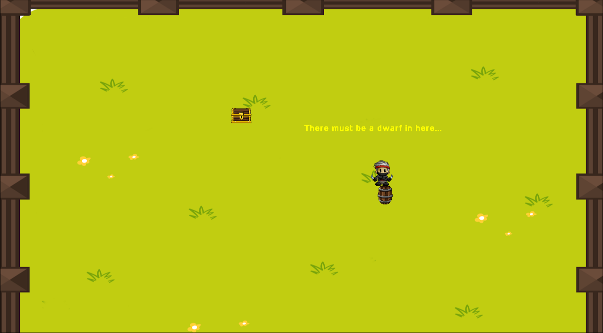

# Java 2D Game Demo 

A small top-down game for my Data Structures & Algorithms final project.
Recently updated to run outside Eclipse.


## Features

- Animated character movement
- Collision detection
- Examinable objects
- Java AWT/Swing graphics

## Run

Requires a Java JDK. Run these commands from the project folder:

```bash
javac -d bin -sourcepath src src/Main/Main.java
java -cp bin Main.Main
```

## Controls

- **WASD** — Move
- **Space** — Examine nearby objects
- **Esc** — Quit
